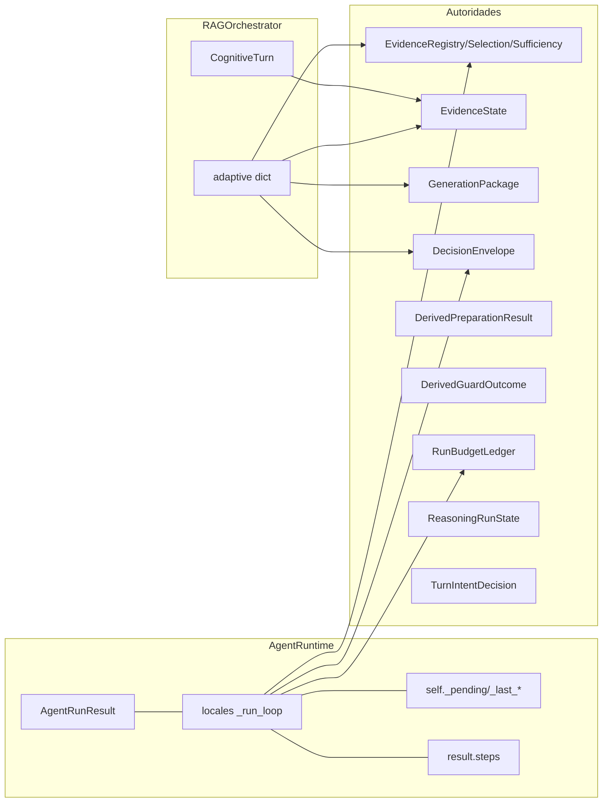
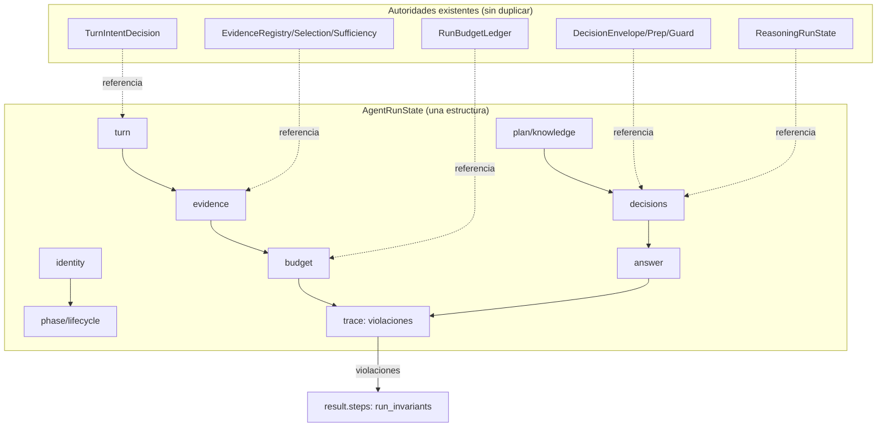

# AgentRunState — estado canónico del run

Estado: **Fases A–E implementadas** (B migra writers y unifica vocabulario; C
migra readers del orquestador; D reutiliza la autoridad y elimina duplicación
segura; E agrega métrica de invariantes y modo estricto opcional). Lo que queda
pendiente por fase está marcado en §4. Verificación: §6.

Regla principal: **no se crea un sistema paralelo**. `AgentRunState` envuelve por
referencia los objetos que ya existen (`EvidenceRegistry`, `EvidenceSelection`,
`EvidenceSufficiency`, `DecisionEnvelope`, `DerivedPreparationResult`,
`RunBudgetLedger`, `ReasoningRunState`, `TurnIntentDecision`) y los expone bajo
una sola capa. Ningún dato se copia y ningún flujo cambia en Fase A.

---

## 1. Auditoría del estado actual

### 1.1 Contenedores de estado

| Contenedor | Dónde vive | Quién escribe | Quién lee | Autoridad real |
|---|---|---|---|---|
| `AgentRunResult` | `src/agents/runtime/agent_runtime.py:535` | 40+ sitios de `_run_loop` | ledger, trazas, `agent_flow`, API | Mixto: campos de contrato |
| `adaptive: dict` | `src/agents/runtime/orchestrator.py:2473` (30+ claves sin esquema) | `execute` y helpers | `_build_flow`, `_evidence_complete`, `_canonical_*`, gates | Derivado |
| Locales de `_run_loop` | `agent_runtime.py:2234-5690` (~40 nombres) | el propio loop | closures internas | Mixto |
| `self._pending_*` / `self._last_*` | `AgentRuntime.__init__` (`agent_runtime.py:1297`) | `_prepare_*`, `_refresh_selection` | `_try_finalize_answer` | Riesgo de carrera entre runs |
| `result.steps` | lista de dicts libres (37 tipos) | pipeline completo | flow/traza/portal | Observacional |
| `EvidenceRegistry` / `EvidenceSelection` / `EvidenceSufficiency` | `src/runtime/evidence.py` | tools y gates | prompt, gates, citas | **Autoritativo (evidencia)** |
| `EvidenceState` | `src/rag/longcontext/coverage.py:309` | `build_evidence_state` | `_evidence_complete`, package | **Autoritativo (cobertura)** |
| `GenerationPackage.ready` | `src/rag/longcontext/package.py:26` | `build_generation_package` | `_evidence_complete` | Derivado de la anterior |
| `DecisionEnvelope` | `src/runtime/decision_envelope.py:91` (constructor único) | `build_decision_envelope` | finalize, fast path, trazas | **Autoritativo (decisión)** |
| `DerivedPreparationResult` | `src/runtime/deterministic_authority.py:365` | `prepare_derived_authority` | gates, fast path | Preparación |
| `DerivedGuardOutcome` | `src/runtime/derived_guard.py:131` | `enforce_derived_result` | finalize | Autoritativo (bloqueo) |
| `RunBudgetLedger` | `src/runtime/run_budget.py:172` | `run_accounting` | guardrails, presupuesto | **Autoritativo (consumo)** |
| `ReasoningRunState` | `src/agents/runtime/reasoning_step.py:49` | motor de razonamiento | prompt, termination gate | Autoritativo (análisis) |
| `TurnIntentDecision` | `src/runtime/turn_intent.py:810` | `resolve_turn_intent` | routing del loop | Autoritativo (clasificación) |
| `CognitiveTurn` | `src/runtime/cognitive_state.py:36` | fases cognitivas | flow, JEV signals | Sombra/activo (RAG) |

### 1.2 Diagrama del estado actual



«¿Cuál es el estado del run?» hoy exige leer `result` + `adaptive` + locales +
steps. El objetivo es una sola estructura.

### 1.3 Duplicaciones semánticas exactas

| Concepto | Representaciones | Ubicación | ¿Misma realidad? |
|---|---|---|---|
| Evidencia completa | `EvidenceSufficiency.evidence_complete`, `EvidenceState.evidence_complete`, `GenerationPackage.ready`, `EvidenceQuality.sufficient`, `_evidence_complete`, `_canonical_evidence_complete` | `evidence.py:864`, `coverage.py:309`, `package.py:26`, `adaptive.py:298`, `orchestrator.py:334-351/431-437` | Sí, parcialmente: cobertura vs. suficiencia |
| Gate de evidencia | `EvidenceSufficiency.recommended_action`, `EvidenceQuality.sufficient`, `_evidence_action` | `evidence.py:901`, `answer_gate.py:494-522` | Sí |
| Autoridad | `DecisionEnvelope.authoritative` (siempre True si existe), `DerivedPreparationResult.has_authority`, `DeterministicResponseFacts.authoritative`, `DecisionVerification.authoritative` | `decision_envelope.py:112`, `deterministic_authority.py:398`, `response_composer.py:252`, `decision_verification.py:108` | Sí: cuatro banderas de la misma realidad |
| Estado de respuesta | `ANSWER_STATE_*` (12 constantes) + `FinalizedAnswer.state` + `prep.answer_state()` + `resolve_answer_state()` | `answer_gate.py:86-140`, `decision_envelope.py:414-422`, `deterministic_authority.py:409-450` | Sí: dos builders + literales duplicados |
| Análisis completo | `ReasoningRunState.analysis_complete` + `blocks_early_answer` + `should_block_direct_answer` + `record_termination_skipped` | `reasoning_step.py:62-75/114/627`, `agent_runtime.py:4944` | Sí |
| Conversacional vs. conocimiento | `TurnIntentDecision.needs_external_evidence` vs `CognitivePlan.requires_knowledge` | `turn_intent.py:818`, `cognitive_plan.py:53` | Misma pregunta en dos caminos que nunca se comparan |
| Retrieval pedido | `TurnIntentDecision.route`, `KnowledgeStrategy.representations`, `CognitivePlan.needs` | agent path vs. RAG path | Tres encodings del mismo pedido |
| Presupuesto | `result.llm_calls/tool_calls/logical_steps` (ledger) vs `tool_calls` local, `budget_step`, `_steps_left()` | `agent_runtime.py:2432-2465`, `run_budget.py:172` | Sí: contadores paralelos |
| Fallo de retrieval | `_retrieval_unavailable`, `failed_tools`, `stale_tool_streak`, `retrieval_exhausted`, `adaptive["retrieval_failure"]` | `agent_runtime.py:917/2433/2507-2508`, `orchestrator.py:3208` | Distintas causas, hoy indistinguibles de «sin datos» |
| Cobertura de entidades | `EvidenceSufficiency.entity_coverage` vs `ConceptCoverage.entity_status` | `evidence.py:993`, `narrative_coverage.py:132` | Parcial: misma contención calculada dos veces |
| Identidad de evidencia | `_item_key` (`evidence.py:88`) vs `_excerpt_key` (`evidence_assembly.py:112`) | `E{n}` vs `U{n}` | Misma lógica, dos espacios |

### 1.4 Recalculadores detectados (a eliminar en Fase D)

1. `_refresh_selection` re-ejecuta selección + suficiencia + presentación + package (8 call sites).
2. `_sufficiency_complete` recalcula completitud ya calculada por `assess_sufficiency`.
3. `_coverage_history_note` y `_uncovered_labels` reconstruyen `EvidenceState` por ronda.
4. `resolve_answer_state` y `prep.answer_state()`: dos builders del mismo vocabulario.
5. `fast_path` re-chequea estado ya derivado por `prepare_derived_authority` (authority, claims, missing, conflicts).
6. `_apply_derived_guard` y `finalize_authoritative_answer` re-construyen el envelope desde `grounded_public`.
7. `has_usable_evidence` + `sufficiency.generate` + `_history_has_usable_observation`: tres respuestas a «¿se puede responder?».
8. `budget_step` vs `ledger.remaining_steps`; `tool_calls` local vs `result.tool_calls`.
9. `_citations_from_evidence` vs `citations_payload` (dos extracciones de citas).
10. `retrieval_failed` (orquestador) se mezcla con `adaptive_insufficient` en la decisión de respuesta.

---

## 2. Contrato canónico

### 2.1 Capas de autoridad

| Capa | Regla | Campos |
|---|---|---|
| **AUTHORITATIVE** | Decide el resultado. Un escritor observacional jamás la cambia. | `evidence` (registry/selection/sufficiency), `decisions` (envelope/prep), `budget` (ledger), `tools.allowed/used`, `turn.decision`, `reasoning.run`, `identity` |
| **DERIVED** | Se calcula de la autoridad; nunca la contradice. | `plan`, `knowledge`, `answer` (texto/estado), `evidence.complete/insufficient` |
| **OBSERVATIONAL** | Traza, JEV shadow, timings, notas. Nunca muta autoridad. | `trace`, `decisions.jev`, `tools.failures`, `budget.stop_reason` (razón precisa del corte; la representación muerta `last_cut_reason` se eliminó en el hardening P1-7) |

### 2.2 Estructura (`src/runtime/run_state.py`)

```python
@dataclass(kw_only=True)
class AgentRunState:
    identity: RunIdentity        # ids y tenant (AUTHORITATIVE)
    phase: RunPhase              # lifecycle explícito
    turn: TurnState              # envuelve TurnIntentDecision
    plan: PlanningState          # plan/estrategia/response_plan (DERIVED)
    knowledge: KnowledgeState    # entidades/package narrativo (DERIVED)
    evidence: EvidenceView       # envuelve registry/selection/sufficiency + sets
    reasoning: ReasoningView     # envuelve ReasoningRunState
    tools: ToolState             # allowed/used/calls
    budget: BudgetState          # envuelve RunBudgetLedger
    decisions: DecisionState     # DecisionEnvelope + prep + guard + estado final
    answer: AnswerState          # texto/estado/citas (DERIVED)
    trace: TraceState            # phase_history + notes + violations
```

Reglas de diseño vigentes:

- Los holders guardan **referencias**, no copias (`evidence.registry is registry`).
- `DecisionState.set_envelope` **no reemplaza** una autoridad con contenido
  distinto en silencio: marca `envelope_conflict` y viola invariante en el cierre.
- `EvidenceView.complete` delega en `EvidenceSufficiency.evidence_complete`
  (o en `EvidenceState` para el camino RAG); no redefine completitud.
- `TraceState.phase_history` se auto-registra; una transición inválida se registra
  como nota y no mueve la fase (jamás rompe el run).
- Claves engine-native del motor adaptativo (`plan`, `quality`, `evidence`,
  `attempts`): el estado es la fuente (`plan.adaptive_plan`,
  `evidence.engine_evidence/engine_quality/retrieval_attempts`, mismas
  referencias que la proyección); `adaptive` es proyección legacy y el writer
  único es `_adaptive_write` + `_adaptive_publish`
  (`tests/test_adaptive_projection.py`).

### 2.3 Lifecycle

```
CREATED → CLASSIFIED → PLANNED → EVIDENCE_REQUIRED → RETRIEVING → REASONING
        → ACTION_REQUIRED → ACTING → … (loop) → READY_TO_FINALIZE → FINALIZED
```

Terminales: `FINALIZED`, `ABSTAINED`, `BLOCKED`, `FAILED`, `LIMIT_REACHED`,
`UNDETERMINED`. Mapeo por código en `terminal_phase_for` (§2.4, invariante 1).

Desde la fase de convergencia de autoridad, `terminal_phase_for` es el
**oráculo** del cierre: la fase aplicada sale de
`finalization_policy.resolve_closure_phase` (§2.4, invariantes 11 y 12). El
texto de la respuesta no decide la fase.

Transiciones válidas (tabla `_TRANSITIONS`, `run_state.py`):

| Desde | Hacia |
|---|---|
| CREATED | CLASSIFIED, PLANNED, terminales |
| CLASSIFIED / PLANNED | EVIDENCE_REQUIRED, RETRIEVING, REASONING, ACTION_REQUIRED, READY_TO_FINALIZE, terminales |
| EVIDENCE_REQUIRED / RETRIEVING | REASONING, ACTION_REQUIRED, READY_TO_FINALIZE, terminales |
| REASONING | EVIDENCE_REQUIRED, RETRIEVING, ACTION_REQUIRED, READY_TO_FINALIZE, terminales |
| ACTION_REQUIRED | ACTING, RETRIEVING, REASONING, READY_TO_FINALIZE, terminales |
| ACTING | REASONING, EVIDENCE_REQUIRED, RETRIEVING, ACTION_REQUIRED, READY_TO_FINALIZE, terminales |
| READY_TO_FINALIZE | terminales |
| terminal | (sin salida) |

### 2.4 Invariantes comprobables

Implementadas en `AgentRunState.check_invariants()` y ejecutadas al cierre
(`finalize_state`); las violaciones se guardan en `trace.violations`, se loguean
y generan un step `run_invariants` solo cuando existen.

| # | Invariante | Código de violación |
|---|---|---|
| 1 | Fase terminal con respuesta obligatoria => `answer != ""` | `terminal_phase_without_answer:<fase>` |
| 2 | `requires_deterministic` + FINALIZED => `DecisionEnvelope` existe | `deterministic_finalized_without_envelope` |
| 3 | Envelope autoritativo => el resultado no se contradice | `authoritative_decision_contradicted` |
| 4 | `budget.exhausted` => 0 llamadas caras posteriores | `expensive_calls_after_budget_exhausted:<n>` |
| 5 | `tool_call` => tool ∈ allowlist efectiva | `tool_executed_outside_allowlist:<tools>` |
| 6 | `evidence.cited ⊆ evidence.used ⊆ evidence.selected` | `evidence_chain:<detalle>` |
| 7 | `analysis_complete=False` complejo => sin cierre normal | `incomplete_analysis_finalized` |
| 8 | `retrieval_failed != evidence_insufficient` | `retrieval_failure_reported_as_insufficiency` |
| 9 | La autoridad no se reemplaza con contenido distinto | `authoritative_decision_replaced` |
| 10 | Cobertura narrativa no pide búsqueda con evidencia completa | `coverage_search_after_evidence_complete` |
| 11 | Un cierre `FINALIZED` exige autorización de la política de cierre | `closure_not_authorized:<acción>:<reason_code>` |
| 12 | La fase aplicada no puede diferir del oráculo sin quedar registrada | `closure_authority_mismatch:<oráculo>-><fase>:<reason_code>` |

Notas de autoridad (fase de convergencia, ADR-004):

- La fase terminal la aplica `finish(phase_override=...)` desde
  `finalization_policy.resolve_closure_phase` (reducer único). `terminal_phase_for`
  queda como **oráculo de consistencia**: si difiere, manda la autoridad y la
  divergencia es una violación crítica (11/12). Los invariantes 2 y 7 quedan
  inalcanzables en caminos productivos y siguen vigentes como defensa.
- `decisions.closure` publica la resolución aplicada (fase, oráculo, kind,
  mismatch, acción y autoridad). Escritor único: `observe_closure`.
- `RUNTIME_RUN_STATE_STRICT` es un campo real de `Settings` (default `off`); el
  fail-closed del cierre es ese modo (global o canary por org/agente).

### 2.5 Diagrama del estado propuesto



---

## 3. Implementación (Fases A–E)

### 3.1 Código

| Archivo | Cambio |
|---|---|
| `src/runtime/run_state.py` (nuevo, 868 LOC) | `AgentRunState` + holders + `RunPhase` + invariantes + `finalize_state` + modo estricto + métrica |
| `src/runtime/answer_state.py` (nuevo, 60 LOC) | Vocabulario único de estados de respuesta (`ANSWER_STATE_*`, sets operativos/abstención/indeterminado) |
| `src/agents/runtime/agent_runtime.py` (+200/−7) | estado creado en `run()`; writers publican turn/plan/tools/evidence/decisions/budget; envelope reutilizado (Fase D); invariantes + métrica + bloqueo estricto |
| `src/agents/runtime/orchestrator.py` (+261/−34) | **estado vivo** durante `execute` (Fase B): plan, turn, retrieval, evidencia, grounded, envelope, package, sufficiency, long-context; **readers migrados** (Fase C): `_evidence_complete`, `_canonical_derived`, `_coverage_block`, `_canonical_evidence_complete`, `correct_decision_with_canonical_evidence`, `_contradictory_disclaimer`; envelope reutilizado en la finalización (Fase D) |
| `src/runtime/derived_guard.py` (+26/−3) | `is_deterministic_supported_claim`: definición única de claim autoritativo |
| `src/runtime/deterministic_authority.py` (+5/−5) | `has_authority` usa la definición única; constantes desde `answer_state` |
| `src/runtime/decision_envelope.py` (+20/−12) | `FinalizedAnswer.state` sin literales duplicados |
| `src/runtime/answer_gate.py` (+14/−12) | re-exporta el vocabulario único |
| `src/infrastructure/observability/metrics.py` (+7) | `zent_run_state_violations_total{path,kind}` |
| `src/core/domain/entities.py` (+3) | `RAGQueryResult.run_state` (campo aditivo) |
| `tests/test_run_state.py` (nuevo, 515 LOC) | 39 tests: lifecycle, mapeo terminal, 9 invariantes, agregación, wiring runtime, modo estricto y métrica |

Puntos de publicación en el AgentRuntime:

- `run()` → crea el estado con `RunIdentity` y lo cierra con `finalize_state`
  después de la barrera final de consultas ejecutables.
- `_run_loop` → `CLASSIFIED` (turno), `PLANNED` (tools/plan), `REASONING`
  (primera generación), `ACTION_REQUIRED/RETRIEVING/ACTING` (ejecución de tool),
  `EVIDENCE_REQUIRED` (suficiencia pide más) y `READY_TO_FINALIZE`.
- `_refresh_selection` / `_publish_evidence` / `_publish_authority_prep` /
  `_apply_derived_guard` / `_try_finalize_answer` → publican sus objetos.
- Fallo transitorio de una tool de retrieval → `evidence.retrieval_failed`.

Puntos de publicación en el RAGOrchestrator (estado vivo, Fase B):

- Plan del turno → `PLANNED`; clasificación → turn snapshot; retrieval →
  `RETRIEVING`; generación → `REASONING`; finalización → `READY_TO_FINALIZE`.
- Evidencia: `registry/selection/sufficiency/evidence_state/long-context` y
  `generation_package`; decisiones: `grounded_public`, envelope (objeto y
  público), `query_executable`; respuesta: `finalize_state` en el `finally`.

### 3.2 Consulta del estado

```python
result = await runtime.run(request)
state = result.run_state            # AgentRunState
state.phase                         # RunPhase.FINALIZED
state.evidence.complete             # bool (delegado a sufficiency/canonical)
state.decisions.authoritative       # bool (DecisionEnvelope real o público)
state.trace.violations              # [] = consistente
state.critical_violations()         # subconjunto que bloquea en modo estricto
state.to_public_dict()              # proyección JSON para portal/diagnóstico
```

Camino RAG: `result = await orchestrator.execute(...)`, luego `result.run_state`
(misma estructura, `identity.kind == "rag"`).

### 3.3 Eliminación de código duplicado (Fases B–D)

Eliminado o unificado:

- Estado de salidas tempranas: `_early_run_state` (antes identidad+fase repetida
  por rama).
- Colisión de nombres `state` en cierres del runtime (`answer_state_code`).
- Vocabulario de estados de respuesta: `answer_state.py` es la única definición;
  `FinalizedAnswer.state` y `deterministic_authority` la consumen.
- Autoridad por claim: `is_deterministic_supported_claim` es la única regla;
  `has_authority` y `deterministic_claims` la comparten.
- Envelope: la finalización (agente y RAG) reutiliza la autoridad ya preparada
  en lugar de reconstruirla desde el grounded público.
- Readers del orquestador: leen el estado canónico (fallback `adaptive` solo
  para caminos viejos).

No eliminado todavía (semánticas no idénticas; cualquier borrado cambia
respuestas sin migración previa):

- `_sufficiency_complete` (`agent_runtime.py`) vs
  `EvidenceSufficiency.evidence_complete` (el primero no exige
  `supporting_chunks`).
- `resolve_answer_state` vs `prep.answer_state()` (insumos distintos).
- Rechequeos del fast path; siguen siendo la verificación de elegibilidad.
- `narrative_coverage` y `EvidenceSufficiency` calculan contención de entidades
  por separado.

---

## 4. Plan de migración incremental

### Fase A — agregador (✅ hecha)

Introducir `AgentRunState` y publicar los estados existentes sin cambiar writers,
readers, contratos ni flujos. Criterio: tests existentes verdes.

### Fase B — migrar writers (✅ completa)

Hecho:

1. `RAGOrchestrator.execute`: estado vivo; `adaptive` es una **proyección**
   (`_adaptive_publish`) de los campos modelados — plan, turn, registry/selection,
   sufficiency, evidence_state, grounded, envelope (objeto y público),
   generation_package, long-context, query_executable y response_plan.
2. Vocabulario único de respuesta (`answer_state.py`).
3. Autoridad por claim única (`is_deterministic_supported_claim`); la consumen
   `has_authority`, `deterministic_claims`, `DecisionVerification` y
   `DeterministicResponseFacts` (sin literales de estado).
4. Contador único de tools: `result.tool_calls` (loop, ledger, usage y cierre);
   `budget_step` es solo el índice del loop (no era un contador paralelo).
5. `has_usable_evidence` se lee de `EvidenceView.can_answer`.

### Fase C — migrar readers (✅ orquestador; ⏳ gate JEV por decisión de producto)

1. ✅ `_evidence_complete`, `_canonical_derived`, `_coverage_block`,
   `_canonical_evidence_complete`, `correct_decision_with_canonical_evidence` y
   `_contradictory_disclaimer` leen el estado canónico (fallback `adaptive`).
2. ✅ Gates JEV: `judge_answer` reusa la suficiencia canónica del estado cuando
   la evidencia es exactamente la misma (identidad de objetos) y la ronda de
   retrieval no cambió (`reuse_canonical_sufficiency`); fuera de eso recalcula
   como siempre. `termination`/`tool_routing` reciben sus insumos explícitos del
   loop (no recomputan estado).
3. ✅ La traza publica las violaciones: step `run_invariants` (merge de
   `result.steps` en el flow de ambos caminos) + `zent_run_state_violations_total`.
   No se agregó una clave nueva al payload del flow para no tocar contrato.

### Fase D — eliminar recalculadores (✅ lo seguro; ⏳ lo demás con razón)

Hecho:

1. Envelope reutilizado en la finalización de ambos caminos (agente y RAG).
2. `FinalizedAnswer.state` sin literales duplicados.
3. `has_authority` sin la lógica de claims duplicada.
4. Construcción del estado temprano centralizada (`_early_run_state`).
5. `_sufficiency_complete` delega en `EvidenceSufficiency.evidence_complete`
   (la completitud positiva sale de la definición canónica) con el fallback
   histórico documentado para no cambiar respuestas.
6. Builder único de estado de respuesta: `answer_state.select_answer_state`
   decide la rama (derivado → no-conocimiento → operativo → retrieval →
   conflicto → mismatch → premisa → insuficiencia) y `operational_failure_state`
   es el único mapeo stage/código; `resolve_answer_state`,
   `DerivedPreparationResult.answer_state()` y `finalize_authoritative_answer`
   lo consumen (cada uno aporta sus mensajes).
7. Cobertura narrativa en el estado: `KnowledgeState.coverage` +
   `coverage_search_after_complete` (invariante 10).
8. Eliminados `self._pending_*`/`self._last_*`: el estado de run vive en
   `AgentRunResult.run_state` + scratch `AgentRunResult._runtime` (por run, sin
   carrera entre runs concurrentes).

Diferido con razón:

9. Rechequeos del fast path: son la verificación de elegibilidad (fail-closed),
   no un recalculador de estado.
10. `_item_key` vs `_excerpt_key`: reglas de identidad distintas a propósito
    (documento/chunk vs excerpt de unidad).

### Fase E — endurecer invariantes (✅ métrica, estricto y traza; ⏳ cobertura narrativa)

Hecho:

1. Métrica `zent_run_state_violations_total{path,kind}` emitida por agente y RAG.
2. Modo estricto opcional `RUNTIME_RUN_STATE_STRICT=on` (default off) con helper
   único `strict_mode_enabled`: en agente y RAG, las violaciones críticas
   bloquean la respuesta con el mensaje no concluyente de código.
3. Violaciones visibles en la traza: step `run_invariants` (merge al flow en
   ambos caminos) + logs + métrica.

4. ✅ Invariante de cobertura narrativa (10): la cobertura medida se publica en
   `KnowledgeState` y pedir búsqueda con evidencia completa se registra como
   violación.

---

## 5. Compatibilidad

Preservado (verificado por la suite de §6):

- `AgentRunResult`/`RAGQueryResult`: campos nuevos aditivos con default `None`;
  ningún campo existente cambia de forma. Los builders de payload
  (`_run_payload`, `_sse`, `_run_payload`, MCP, SDK) usan claves fijas y no
  incluyen `run_state`.
- SSE (`status/delta/done/error`), portal, Agent Studio, traces, `DecisionEnvelope`,
  JEV, workflows, tools, MCP, SDK y multi-tenant: sin cambios de contrato.
- `adaptive` sigue publicándose con las mismas claves (los readers legacy y el
  flow no cambian).
- `_run_loop` conserva su firma (los dobles de test que monkeypatchean
  `_run_loop` siguen funcionando: el estado se adjunta a `result.run_state`).
- Persistencia (`trace_store.save_run`) usa columnas explícitas: el campo nuevo
  no se persiste por accidente.
- `RUNTIME_RUN_STATE_STRICT` es opcional y default `off`: sin flag, ninguna
  respuesta cambia (solo se registran violaciones).

---

## 6. Métricas antes/después (Fases A–E)

| Métrica | Antes | Después | Nota |
|---|---|---|---|
| Fuentes de verdad consultables | 6+ (`result`, `adaptive`, locales, instancia, steps, objetos) | 1 (`AgentRunState`) + compat | Los writers siguen publicando también en `result`/`adaptive` (Fase B parcial) |
| Readers del RAG que reconstruyen estado | 6 (`_evidence_complete`, `_canonical_derived`, `_coverage_block`, `_canonical_evidence_complete`, `correct_decision...`, `_contradictory_disclaimer`) | 0 (leen el estado; fallback `adaptive`) | Fase C |
| Estados recalculados por run | 13 detectados (§1.4) | ~8 | Fase D eliminó envelope (×2), autoridad, contador de tools, completitud, builder de estado y el fallback por instancia |
| Banderas de «evidencia completa/suficiente» | 4 | 4 activas + 2 lecturas canónicas (`EvidenceView.complete`, `_sufficiency_complete` delega) | Unificación total al mover el modelo de cobertura |
| Banderas de autoridad | 4 | 3 unificadas (`has_authority`, `deterministic_claims`, `DecisionVerification`) + 1 canónica (`DecisionState.authoritative`) | `facts.authoritative` lee el vocabulario único (constante) |
| Duplicaciones eliminadas | — | 16 (vocabulario, autoridad ×2, envelope ×2, contador de tools, completitud, literales del composer, identidad, colisión, transiciones, sync adaptive, selector de estado, mapeo stage/código, scratch por run, reuso de suficiencia, cobertura) | Ver §3.3 y §4 |
| Estado compartido entre runs concurrentes | 4 attrs de instancia (`_pending_*`, `_last_*`) | 0 (scratch por run en `AgentRunResult._runtime`) | Fix de carrera real |
| Lifecycle explícito | 0 (implícito en código) | 15 fases + 10 transiciones válidas + terminales | Agente y RAG |
| Invariantes comprobables | tests dispersos | 10 invariantes + tests dedicados + métrica + modo estricto | Violaciones → `trace.violations`, step y `zent_run_state_violations_total` |
| LOC (tracked) | — | +539/−74 | runtime +200/−7; orquestador +261/−34; soporte +75/−32 |
| LOC (nuevos) | — | 868 (run_state) + 60 (answer_state) + 515 (tests) + 434 (doc) | — |
| Branches de control del runtime | — | +0 ramas de decisión nuevas | Transiciones inválidas se registran; el modo estricto está detrás de un flag |
| Latencia | — | Sin cambio esperado | Referencias y fallbacks baratos; medir con spans en producción |

Verificación ejecutada (2026-10-11, `pytest` con `.venv`, Postgres/Redis locales):

| Suite | Resultado |
|---|---|
| `tests/test_agent_runtime.py` | 37 passed |
| `tests/test_run_state.py` (nuevos) | 39 passed |
| Batch de 14 suites: `test_agent_reasoning_integration`, `test_evidence_first_gate`, `test_fail_closed_authority`, `test_runtime_audit_36`, `test_decision_wiring`, `test_canonical_evidence`, `test_rag_stream`, `test_agent_flow_v2`, `test_final_authority_lock`, `test_deterministic_fast_path`, `test_decision_engine`, `test_production_consistency`, `test_adaptive_rag`, `test_answerability_engine` | 381 passed |
| `ruff check` (archivos tocados) | limpio |

Cierre B–E (misma fecha, commits `f955279`, `72cfccb`, `6e80b87`):

| Suite | Resultado |
|---|---|
| `test_run_state` + `test_canonical_evidence` + `test_agent_runtime` + `test_run_accounting` + `test_run_budget` + `test_agent_budget_closure` | 121 passed |
| `test_response_composer` + `test_verification_split` + `test_narrative_verification_bridge` + `test_evidence_usage_trace` + `test_decision_wiring` + `test_agent_flow_v2` + `test_deterministic_fast_path` + `test_final_authority_lock` + `test_fail_closed_authority` + `test_production_consistency` + `test_answerability_engine` + `test_bundle_atpco` | 287 passed |

Cierre de pendientes 1–4 (commits `1140b89`, `49ef292`):

| Suite | Resultado |
|---|---|
| `test_fail_closed_authority` + `test_deterministic_fast_path` + `test_production_consistency` + `test_answerability_engine` + `test_runtime_audit_36` + `test_adaptive_rag` + `test_decision_wiring` + `test_evidence_first_gate` + `test_agent_reasoning_integration` + `test_narrative_coverage` + `test_inference_proxy` + `test_model_health` + `test_traces` + `test_notifications_v2` | 345 passed |
| `test_run_state` (selector, reuso, scratch, cobertura) + `test_fail_closed_authority` + `test_deterministic_fast_path` (post-fix de mensaje default) | 95 passed |

Total acumulado: **1305 ejecuciones verdes, 0 fallos**.

---

## 7. Próximo paso sugerido

1. Fast path: decidir si su verificación de elegibilidad se muda al estado
   (hoy es fail-closed propio y no un recalculador).
2. Unificar `_item_key`/`_excerpt_key` si el modelo de identidad de evidencia
   converge (hoy son reglas distintas a propósito).
3. Observar `zent_run_state_violations_total` en producción antes de pasar
   algún invariante a bloqueante por defecto.
