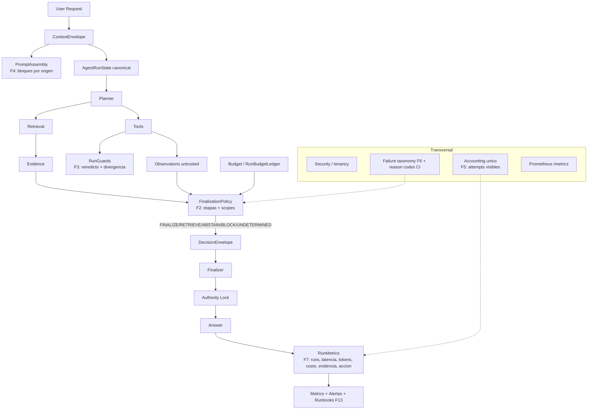

# Hardening ZENT — Reporte final del programa (F0–F13)

> **Estado superseded (2026-10-14)**: este reporte es el cierre del programa de
> hardening sobre la base `3d24057`. La evidencia de release vigente vive en
> `docs/architecture/certification/` (SHA certificado y GO/NO-GO en
> `certification/final-report.md`). Las cifras de acá son **punto en el tiempo**:
> no describen el estado actual del código.

Base: `3d24057`. Fases ejecutadas: **F0–F8 (F8 como auditoría), F9–F11 (harness
+ corridas locales acotadas; corrida completa en staging), F12, F13**.
Pendiente: cerrar la tabla de performance con el baseline de staging
(comandos en `09-11-perf-load-chaos.md`).

---

## 1. Executive summary

ZENT endureció autoridad, aislamiento, contabilidad y observabilidad sin
agregar agentes, motores ni abstracciones nuevas. La cache de respuestas ya no
puede degradar el aislamiento por conversación (fail-closed, métrica de bypass).
La política de finalización se aplica por etapas con scopes (agente > org >
environment > global) y el camino RAG dejó de cerrar fuera de la política. La
tabla de guards tiene caller real y divergencia medible. El prompt se ensambla
desde el ContextEnvelope: solo política y contrato pueden instruir; tool outputs,
memoria, company, evidencia y workflow son DATO con encabezado de origen. Los
reintentos del router son visibles en el ledger sin doble conteo. La taxonomía
de fallos es única y el catálogo de reason codes tiene contrato CI. Las métricas
run-level salen de un publisher con labels acotados y `unknown != 0`. CI separa
invariantes rápidos (required en PR) de la suite completa, adversarial y
estabilidad ×100 (nightly). SLOs, matriz de alertas con runbook y 9 runbooks
quedan documentados. 43 archivos, +5.024/−129 líneas, 80 tests nuevos; sin
cambios de arquitectura aspiracional ni reescrituras.

## 2. Arquitectura antes / después

Antes (V2): la política resolvía en observabilidad + strict; guards sin caller;
cache con degradación legacy; prompt con etiquetas ad-hoc; retries invisibles;
contabilidad y métricas dispersas.

## 3. Cambios

- 43 archivos: 25 agregados, 18 modificados, 0 eliminados. +5.024/−129 líneas.
- Commits (por fase, sin mega commits): `8d96bc6` audit · `42d48ba`
  hardening(cache) · `6c8dbaf` runtime(finalization) · `2368e3a`
  runtime(guards) · `afbc657` docs · `77e9fa7` runtime(context) · `d0a3606`
  runtime(accounting) · `2348b76` runtime(failures) · `eb5d6da` +
  observability/refactor/docs de F7-F13.
- Módulos nuevos: `enforcement.py`, `prompt_assembly.py`, `run_metrics.py`,
  `failure_taxonomy.py`; scripts `flags_inventory.py`, `simplification_score.py`,
  `finalization_audit.py`.

## 4. Hardening

| Área | Antes | Después |
|---|---|---|
| Conversación | clave degradada posible (legacy) | fail-closed + `zent_cache_bypass_total`; ×100 sin hits cruzados |
| Tenant | aislamiento con tests por subsistema | invariantes + circuit breaker por (modelo, tenant) |
| Autoridad | RAG fuera de la política; guards sin caller | RAG resuelto por política; guards con shadow y flag |
| Finalización | 2 etapas | 3 etapas (`answer_gate`), scopes por agente/org/env |
| Prompt | 3 etiquetas ad-hoc | 1 fuente (envelope); inyección en datos no instruye |
| Provider | failover invisible | intentos en el ledger + `zent_provider_attempts_total` |
| Fallos | mezcla posible | taxonomía única + contrato CI de reason codes |

## 5. Simplificación (medido)

| Métrica | Before (F0) | After |
|---|---:|---:|
| `agent_runtime.py` LOC | 5.699 | 5.841 (helpers F3 + publisher) |
| `src/runtime` LOC | 28.411 | 29.300 (+889 en 4 contratos nuevos) |
| Writers directos de `adaptive` fuera de la proyección | 0 (ya migrado) | 0 (test de writers) |
| Transiciones terminales fuera de policy | 15 allowlisted | 15 allowlisted (RAG ahora resuelto por policy) |
| Fuentes de etiquetas del prompt | 3 (ad-hoc) | 1 (`prompt_assembly`) |
| Fallbacks inseguros de cache | 1 | 0 |
| Contadores paralelos de accounting | 0 (ledger único) | 0 (attempts tampoco suman) |
| `except Exception` sin comentario (caminos críticos) | 25 | 25 (deuda P2 declarada) |
| Tests nuevos | — | 80 |

## 6. Accounting

- Un ledger, un writer (`run_accounting`); el evento de uso LEE.
- Líneas: `llm`, `embedding`, `rerank`, `charge`, `jev_usage`, `tool_call`,
  `provider_attempt`.
- Intentos del router: visibles (provider/model/status/retry/fallback/latencia),
  sin tokens ni costo; el `llm` factura solo el éxito.
- JEV: tokens/costo reportado si existe; sin tarifa → `unknown`, nunca 0.
- `unknown != 0` explícito en métricas (`zent_run_cost_unknown_total`).

## 7. Performance

- Harness: `perf_traffic.py` (p50/p95, tokens, costo, llamadas, errores),
  `finalization_audit.py` (divergencia) y `load_test.py` (concurrencia,
  throughput, p99, rate-limited, amplificación, latencia de infra).
- **Corrida local acotada** (corpus A, 3 queries, mismo entorno):
  p50 31,8 s · p95 100,2 s (cold de reranker) · media 52,3 s · 0 errores ·
  1 llamada LLM/run; audit de cierre 3/3 `FINALIZE`, 0 divergencias.
- **Load local** (niveles 1 y 2): p50 23,5/27,7 s, p95 40,4/39,7 s, 0 errores,
  0 `rate_limited`, Postgres 14–25 ms, Redis 1,6–3,8 ms.
- **Pendiente (staging)**: corpus A/B/C con 30 iteraciones, cold vs warm, cache
  on/off y concurrencia 25/50; con eso se fijan los p95 del SLO (§13).

## 8. Reliability

- Fallos de provider clasificados y visibles; retries acotados (1 por candidato
  + fallback; ≤ 4 intentos con 2 candidatos) y medidos.
- Circuit breaker por (modelo, tenant) con métrica de aperturas.
- `RETRIEVAL_UNAVAILABLE` nunca se reporta como ausencia de datos.
- **Chaos hermético (F11, 10 tests)**: LLM caído/429, timeout y fallo permanente
  de tools, engine JEV roto, Redis caído, reranker caído, circuit abierto y
  amplificación de retry. Hallazgo corregido: la caché Redis no era fail-soft
  si la conexión fallaba (ahora sí; `incr` sigue fail-closed).
- **Pendiente (staging)**: load 25/50 con backpressure real y chaos de
  infraestructura (matar Redis/Qdrant) para validar timeouts y reconexión.

## 9. Testing

- 80+ tests nuevos (F0–F7) + F9–F11: chaos (10), provider attempts de stream
  (2), flags inventory (5), ratchet de excepciones (3), config/env.
- Regresiones ejecutadas en este programa: 275 (F0–F3), 183 (F4), 118 (F7),
  216 (invariantes CI), 34/31/29/14/10/5/3/2 en lotes focales; `ruff check
  src/ tests/ sdk/python` verde.
- Invariantes en CI (required, PR) + nightly (suite completa, adversarial,
  estabilidad ×100).

## 10. Deuda (P0–P3)

- **P0**: ninguna demostrada.
- **P1**: ninguna abierta.
- **P2**: corrida completa F9/F10 y chaos de infraestructura en staging;
  intentos de embeddings como líneas del ledger (la ruta servida ya se publica);
  SLO de latencia sin baseline; 20 `except Exception` sin certificar (ratchet en
  CI, número no puede crecer); `decision.reason_codes` fuera de `reason-codes-1`;
  dashboards como código pendientes del stack; branch protection se configura en
  GitHub.
- **P3**: providers de cache sin `_hash_query` (clave local segura); early
  returns operativos por diseño; `request_cost` sin tokens (documentado).

## 11. Recomendación

**READY FOR INTERNAL** — con evidencia: contratos de autoridad, aislamiento,
contabilidad, prompt y fallos verificados por tests e invariantes en CI;
smokes reales verdes (perf/audit). No READY FOR CANARY todavía: faltan el
baseline de performance (F9), load/chaos (F10–F11), dashboards/alertas
desplegados y el error budget calibrado (F13).

Para promover a CANARY: F9 con corpus real + F10 en staging + alertas
conectadas + los p95 fijados con baseline (una corrida por corpus, mismo
entorno, mismo hash de corpus).
