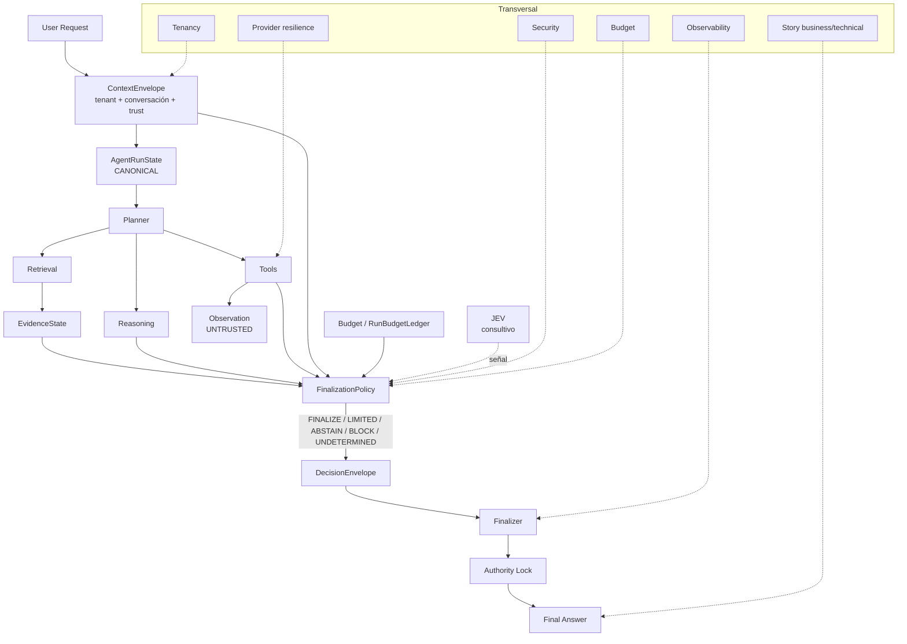

# V2 Consolidation Report — Agent Runtime de ZENT

Cierre del programa de consolidación (V2) sobre el runtime. Referencia:
`principal-audit.md` (hallazgos y roadmap), `finalization-policy.md`,
`run-accounting.md`, `narrative` y `agent-run-state.md`.

## 1. Fases

| Fase | Alcance | Estado |
|---|---|---|
| Contabilidad RAG | Ledger único, evento lee del ledger, líneas embedding/rerank/JEV | hecho |
| Resolver (shadow) | Métrica `stage`, triggers termination/draft gate | hecho |
| Reason codes | Catálogo único versionado (`reason-codes-1`) | hecho |
| Aislamiento | Clave de respuesta y helper de historial con conversación | hecho |
| Adaptive | 37 claves modeladas en el estado; writer único + proyección | hecho |
| Narrative fast path | 9 pasos extraídos al módulo (780 a ~359 líneas en el closure) | hecho |
| Finalizer | 7 pasos extraídos (`finalizer.py`); parseo, cierre determinista, prompt, generación | hecho |
| Enforcement (A1) | `RUNTIME_FINALIZATION_ENFORCE` activo por defecto en termination/draft gate | hecho |
| Canary estricto (A2) | Config por agente + orgs canary para el modo estricto | hecho |
| Prompt por origen (B1) | Company/memoria/workflow con encabezado del sobre | hecho |
| Invariantes de texto (C1) | Todos los estados con texto verificado | hecho |
| Intentos de provider (D1) | Línea explícita de intento fallido en el ledger | hecho |
| Perf baseline (F1) | Harness de tráfico real + doc (`perf-baseline.md`) | hecho |

## 2. Métricas arquitectónicas

| Métrica | Antes | Después |
|---|---|---|
| `agent_runtime.py` | 5854 | 5361 |
| Closure `_narrative_fast_path` | ~780 | ~359 |
| `_try_finalize_answer` | ~195 | ~160 (solo orquesta) |
| `src/runtime/narrative_fast_path.py` | 401 | 1210 |
| `src/runtime/finalizer.py` | — | 380 |
| Writers directos a `adaptive` fuera de la proyección | 68 | 0 |
| Autoridades del cierre | policy (shadow) + gates | policy (enforcement ON) + gates como señal |
| Transiciones terminales fuera de policy | 8 | 15 allowlisted con justificación (2 early-return + guards + mapper) |
| Caminos de accounting (RAG) | 2 | 1 (ledger) |
| Fuentes de etiquetas del prompt | ad-hoc por canal | 1 (`PROMPT_BLOCK_HEADERS`) |

## 3. Autoridad antes/después

- **Cierre**: `termination` y `draft gate` ya no cierran cuando la política pide
  RETRIEVE_MORE (enforcement fail-closed, una espera por etapa). El resto de
  acciones sigue el camino previo (strict block para UNDETERMINED/BLOCK).
- **Costo**: el evento de uso RAG lee del ledger; los intentos fallidos de
  provider quedan como línea (status/retry/latencia), sin inventar costo.
- **Vocabulario**: policy y guards emiten solo `reason-codes-1`.
- **Prompt**: la procedencia (origen y trust) sale del `ContextEnvelope`;
  company/memoria/workflow son bloques separados y siguen siendo DATOS.

## 4. Invariantes vigentes

- `ledger.total_tokens == usage_event.total_tokens`; sin tarifa el costo es
  `unknown`, nunca 0.
- `retrieval_failed` nunca se reporta como ausencia de datos (texto).
- Dos conversaciones del mismo tenant no comparten clave de cache ni historial.
- Writers de `adaptive` = 1 (proyección); writers por clave = `_adaptive_write`.
- Transición terminal nueva rompe CI hasta documentarse.
- `decision_matches_terminal` se registra; divergencia visible por stage.

## 5. Tests

- Suites nuevas: accounting RAG/agent, reason codes, aislamiento, streaming
  failover, invariantes de texto, allowlist de transiciones, proyección
  adaptive, encabezados/contexto, finalizer, enforcement.
- Sweeps de regresión ejecutados en cada fase: 500+ tests verdes acumulados
  (agent runtime, flow v2, security, rag query/dispatch/mode, adaptive rag,
  long-context, run state, runtime policies, adversarial matrix, etc.).

## 6. Deuda restante

- **P0/P1**: ninguna conocida (autoridad y seguridad cerradas).
- **P2**: `_try_finalize_answer` restante (~160 líneas de orquestación);
  bloques memory/company del camino narrativo (el agente ya los separa);
  retries internos del router RAG no surfacean al ledger; tarifa del juez JEV
  (sin pricing real).
- **P3**: `request_cost` cuando el LLM no reporta tokens (documentado);
  providers de caché viejos degradan sin conversación en la clave; baseline de
  performance de producción (método listo en `perf-baseline.md`).

## 7. Riesgo y rollback

- A1: rollback por setting (`RUNTIME_FINALIZATION_ENFORCE=""` → solo shadow).
- A2: rollback quitando orgs/data config del canary.
- Adaptive: rollback = revertir el commit; la proyección mantiene readers vivos.
- Contabilidad: revertir el commit restaura el recálculo del evento RAG.
- Todo commit es revertible individualmente; la suite es la red.

## 8. Diagrama final (F3)

